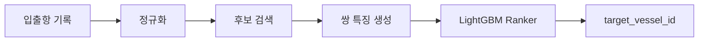

# 항만 입출항 기록 기반 선박 식별

불완전한 항만 입출항 신고 기록 한 행을 입력받아 표준 선박 제원 카탈로그의 `vessel_id`를 예측하는 엔터티 매칭 프로젝트입니다.

동일 선박의 한글·영문 표기 차이, 공백과 특수문자, 철자 변형, 동명 선박, 제원 오차 및 결측치를 함께 처리하는 것을 목표로 합니다.

> 대회 데이터는 참가 목적에 한해 사용하며, 원본 데이터와 식별정보는 이 저장소에 포함하지 않습니다.

## 모델 개요

1. 선박명·호출부호 정규화
2. 문자 단위 TF-IDF와 선박 제원을 이용한 후보 검색
3. 문자열 유사도, 톤수 차이, 국가·선종 일치 여부 등 40개 특징 생성
4. LightGBM LambdaRank 기반 후보 재정렬
5. 한글·비한글 입력별 전략을 결합한 최종 예측



## 검증 전략

단순 무작위 행 분할은 동일 선박이 학습·검증에 동시에 포함되어 점수가 과대평가될 수 있습니다. 이를 방지하기 위해 `target_vessel_id`가 겹치지 않는 선박 단위 홀드아웃 검증을 사용했습니다.

| 항목 | 결과 |
|---|---:|
| 검증 행 | 2,470 |
| 학습/검증 선박 ID 중복 | 0 |
| Candidate Recall@600 | 0.9951 |
| 전체 Top-1 Accuracy | 0.8870 |
| 한글 Accuracy | 0.5785 |
| 비한글 Accuracy | 0.9206 |
| 공식 가중 검증 점수 | 0.6811 |

위 수치는 로컬 홀드아웃 결과이며 실제 Public Score와 동일함을 보장하지 않습니다.

## 프로젝트 구조

```text
port-vessel-matching/
├── src/
│   ├── 01_eda.py
│   ├── 02_validation.py
│   ├── 03_candidate_retrieval.py
│   ├── 04_pair_features.py
│   ├── 05_ranker_train.py
│   └── 06_final_pipeline.py
├── submit/
│   ├── script.py
│   └── requirements.txt
├── requirements-dev.txt
├── .gitignore
└── README.md
```

데이터, 모델 가중치, 예측 결과 및 제출 ZIP은 `.gitignore`로 제외됩니다.

## 환경 설정

Python 3.11 환경을 권장합니다.

```bash
python -m venv .venv
source .venv/bin/activate          # Windows PowerShell: .\.venv\Scripts\Activate.ps1
python -m pip install --upgrade pip
pip install -r requirements-dev.txt
```

대회에서 제공받은 파일은 다음과 같이 직접 배치합니다.

```text
data/
├── train.csv
├── vessel_catalog.csv
└── sample_submission.csv
```

## 실행 순서

```bash
python src/01_eda.py
python src/02_validation.py
python src/03_candidate_retrieval.py
python src/04_pair_features.py
python src/05_ranker_train.py
python src/06_final_pipeline.py --mode train
```

비공개 형식과 같은 `test.csv`가 있을 때 로컬 추론은 다음과 같이 실행합니다.

```bash
python src/06_final_pipeline.py --mode predict \
  --test-path data/test.csv \
  --sample-submission-path data/sample_submission.csv \
  --output-path output/submission.csv
```

## 코드 제출 구조

평가 서버에 제출하는 ZIP의 최상위 구조는 다음과 같습니다.

```text
submit.zip
├── model/
│   ├── ranker_model.txt
│   └── model_metadata.json
├── script.py
└── requirements.txt
```

평가 서버에서 `data/`가 추가되며, `script.py`는 최종 결과를 `output/submission.csv`로 저장합니다.

## 주요 기술

- Python, pandas, NumPy
- scikit-learn TF-IDF 및 최근접 후보 검색
- RapidFuzz 문자열 유사도
- LightGBM LambdaRank
- 그룹 분할 기반 엔터티 매칭 검증

## 데이터 이용 주의사항

- 원본 데이터 및 식별정보를 복원하거나 재배포하지 않습니다.
- 저장소에는 대회 원본 CSV, 모의평가 CSV, 개별 예측값을 올리지 않습니다.
- 대회 종료 후 공개 전환 시에도 주최 측 데이터 이용 규정을 다시 확인해야 합니다.
