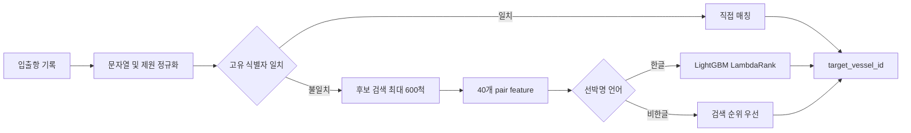

# Port Vessel Matching AI

불완전한 항만 입출항 신고 기록을 표준 선박 제원 카탈로그의 `vessel_id`와 연결하는 엔터티 매칭 프로젝트입니다.

선박명의 한글·영문 표기 차이, 철자 변형, 동명 선박, 톤수 오차와 결측치를 함께 고려합니다. 단순 문자열 비교를 넘어 **후보 검색과 Learning-to-Rank를 결합한 2단계 검색 시스템**으로 설계했습니다.

> 2026 항만 문제해결을 위한 AI 기술 공모전 · 3인 팀 프로젝트  
> 주최: 해양수산부 · 주관: 울산항만공사 / 한국정보산업연합회 · 운영: 데이콘

[포트폴리오 발표자료 PDF](presentation/Port_Vessel_Matching_AI_Portfolio.pdf) · [대회 공식 페이지](https://dacon.io/competitions/official/236771/overview/description) · [포트폴리오 상세 문서](docs/PORTFOLIO_CASE_STUDY.md) · [실험 및 검증](docs/EXPERIMENTS.md)

## 핵심 결과

| 지표 | 로컬 홀드아웃 결과 |
|---|---:|
| 검증 행 | 2,470 |
| 학습·검증 선박 ID 중복 | 0 |
| Candidate Recall@600 | **0.9951** |
| 전체 Top-1 Accuracy | **0.8870** |
| 한글 Accuracy | **0.5785** |
| 비한글 Accuracy | **0.9206** |
| 공식 가중식 기준 점수 | **0.6811** |

평가식은 `0.7 × 한글 정확도 + 0.3 × 비한글 정확도`입니다. 위 수치는 정답 선박 ID가 학습과 검증에 겹치지 않는 로컬 홀드아웃 결과이며, 실제 리더보드 점수와 동일하지 않습니다.

## 문제 정의

입력은 항만 입출항 기록 한 행이고, 출력은 78,595척의 선박 카탈로그에서 선택한 `vessel_id` 하나입니다.

이 문제의 난점은 다음과 같습니다.

- 동일 선박이 한글명, 영문명, 약칭 또는 오탈자로 기록됨
- 공백과 특수문자 규칙이 일정하지 않음
- 같은 이름을 가진 선박이 존재함
- 총톤수와 국제총톤수에 오차 또는 결측이 존재함
- 코드 제출 환경에서 제한 시간 안에 전체 카탈로그를 검색해야 함

## 담당 구현 범위

본 저장소에는 다음 구현을 포함합니다.

- 선박 단위 홀드아웃 검증 설계
- 문자 단위 TF-IDF와 선박 제원을 결합한 후보 검색
- 문자열·톤수·범주형 메타데이터 기반 40개 특징 생성
- Hard Negative 기반 LightGBM LambdaRank 학습
- 한글·비한글 입력에 따른 예측 전략 분기
- 인터넷이 차단된 평가 서버용 단일 추론 스크립트와 제출 패키지 구성

## 시스템 구조



## 접근 방법

### 1. 누수를 줄인 검증

행 단위 무작위 분할에서는 동일 선박의 다른 입출항 기록이 학습과 검증에 함께 들어갈 수 있습니다. 이 경우 호출부호나 정규화된 선박명만으로도 높은 점수가 나와 실제 미관측 선박 성능을 과대평가합니다.

`target_vessel_id` 단위로 학습·검증을 분리해 정답 선박이 겹치지 않도록 구성했습니다.

### 2. 후보 검색

78,595척 전체를 매번 정밀 비교하지 않고, 다음 검색 결과를 합쳐 최대 600척의 후보를 생성합니다.

- 문자 단위 TF-IDF 선박명 검색
- 국가·선종 등 메타데이터 조합 검색
- 총톤수와 국제총톤수 근접 검색
- 전체 톤수 기반 보완 후보

후보 단계에서 정답을 포함하는 것이 랭커 성능의 상한을 결정합니다. 최종 설정의 전체 Candidate Recall@600은 0.9951이었습니다.

### 3. Pair feature와 랭킹

각 입출항 기록과 후보 선박 쌍에 대해 40개 특징을 생성합니다.

- 선박명 exact / ratio / partial ratio / WRatio
- 로마자 문자열 bigram·trigram Jaccard
- 접두어 및 길이 유사도
- 총톤수·국제총톤수 상대 오차와 로그 차이
- 국적·선종 일치 여부
- 메타데이터 조합 빈도와 후보 검색 순위

학습에서는 각 정답 후보와 검색 순위가 높은 오답 후보 40개를 묶어 Hard Negative를 구성하고 LightGBM `lambdarank`로 재정렬했습니다.

### 4. 언어별 최종 전략

비한글 기록에서는 문자열 검색 순위가 강했고, 한글 기록에서는 제원과 메타데이터를 함께 학습한 랭커가 더 안정적이었습니다. 따라서 다음 전략을 결합했습니다.

- 고유 호출부호 또는 고유 정규화 선박명: 직접 매칭
- 미매칭 한글 기록: LightGBM Ranker
- 미매칭 비한글 기록: 후보 검색 1순위

## 실험 비교

| 모델 또는 전략 | 한글 정확도 | 비한글 정확도 | 가중 점수 |
|---|---:|---:|---:|
| Retrieval-first | 0.1901 | 0.9206 | 0.4092 |
| LightGBM Ranker, unweighted | 0.5537 | 0.8308 | 0.6368 |
| LightGBM Ranker, language weighted | 0.5785 | 0.8016 | 0.6454 |
| **Language hybrid** | **0.5785** | **0.9206** | **0.6811** |

단일 모델보다 언어별 강점을 결합한 전략이 공식 가중식에서 가장 높았습니다.

## 저장소 구조

```text
port-vessel-matching-ai/
├── src/
│   ├── 01_eda.py
│   ├── 02_validation.py
│   ├── 03_candidate_retrieval.py
│   ├── 04_pair_features.py
│   ├── 05_ranker_train.py
│   └── 06_final_pipeline.py
├── submit/
│   ├── script.py
│   └── requirements.txt
├── docs/
│   ├── PORTFOLIO_CASE_STUDY.md
│   └── EXPERIMENTS.md
├── presentation/
│   ├── Port_Vessel_Matching_AI_Portfolio.pdf
│   └── README.md
├── requirements-dev.txt
└── README.md
```

## 실행 방법

Python 3.11 환경을 권장합니다.

```bash
python -m venv .venv
source .venv/bin/activate
python -m pip install --upgrade pip
pip install -r requirements-dev.txt
```

Windows PowerShell에서는 가상환경을 다음과 같이 활성화합니다.

```powershell
.\.venv\Scripts\Activate.ps1
```

대회에서 제공받은 파일을 `data/`에 직접 배치합니다. 원본 데이터는 저장소에 포함하지 않습니다.

```text
data/
├── train.csv
├── vessel_catalog.csv
└── sample_submission.csv
```

전체 학습 파이프라인:

```bash
python src/01_eda.py
python src/02_validation.py
python src/03_candidate_retrieval.py
python src/04_pair_features.py
python src/05_ranker_train.py
python src/06_final_pipeline.py --mode train
```

추론 예시:

```bash
python src/06_final_pipeline.py --mode predict \
  --test-path data/test.csv \
  --sample-submission-path data/sample_submission.csv \
  --output-path output/submission.csv
```

## 코드 제출 구조

```text
submit.zip
├── model/
│   ├── ranker_model.txt
│   └── model_metadata.json
├── script.py
└── requirements.txt
```

평가 서버가 `data/`를 추가하면 `script.py`가 인터넷 연결 없이 `output/submission.csv`를 생성합니다. 최종 학습은 공개 학습 데이터 12,222행과 5,851개 선박 ID를 사용했고, 501,102개의 학습 pair를 구성했습니다.

## 한계와 개선 방향

- 한글 선박명의 성능이 비한글 기록보다 낮음
- 후보 검색에서 정답이 빠진 약 0.5%의 사례는 랭커로 복구할 수 없음
- 로마자 변환 규칙과 선박명 음역 학습을 추가하면 한글 성능 개선 가능
- 후보 생성과 재순위를 공동 학습하는 neural retrieval 구조를 후속 실험으로 검토할 수 있음
- 운영 환경에서는 Top-k 추천과 근거 특징을 함께 제공해 데이터 정비 담당자의 검수를 지원할 수 있음

## 데이터 이용 주의사항

대회 데이터는 참가 목적에 맞게 사용해야 하며 원본 식별정보 복원과 허가되지 않은 재배포가 금지됩니다. 이 저장소에는 원본 CSV, 개별 예측 결과, 학습 모델 가중치를 포함하지 않습니다.

